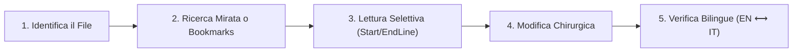

# Protocollo Operativo & Regole per Agenti AI: alessandrobalbina.github.io
> **STATUS**: GUIDA UFFICIALE E REQUISITO OPERATIVO PER GLI AGENTI AI.  
> Questo documento definisce l'architettura, le regole di efficienza dei token e i vincoli di sicurezza del sito web personale e accademico di Alessandro Balbina (`alessandrobalbina.github.io`).

---

## 1. Obiettivo Primario & Efficienza dei Token

Per mantenere massima velocità, reattività e minimizzare il consumo di token senza degradare la qualità:

1. **Memoria Rapida tramite `llms.txt` (Risparmio 93% Token)**:
   - Quando il task richiede di conoscere la biografia, le aree di ricerca, le pubblicazioni o i link di Alessandro, **leggere prioritariamente [`llms.txt`](file:///Users/alessandrobalbina/Documents/Repo/alessandrobalbina.github.io/llms.txt)** (soli ~900 token).
   - Non leggere l'intero `index.html` (~12.800 token) per semplici domande informative o di contesto.
2. **Zero Dump di File Massivi**:
   - **Mai** estrarre, generare o leggere dump di immagini vettoriali SVG o dati Base64 (es. loghi in `assets/`).
   - I file di compilazione offline dei CV (`cv_*.html`, `*.tex`) sono esclusi da `repomix.config.json` e non vanno inclusi nelle scansioni web standard.
3. **Ispezioni Mirate e Chirurgiche**:
   - Usare sempre ricerche mirate (`grep`, `rg`) o consultare la tabella dei **Line Bookmarks** (Sezione 3) prima di leggere un file.
   - Specificare sempre intervalli di riga (`StartLine`/`EndLine`).
   - Su `styles.css`, **saltare sempre le righe 1–420** (contengono solo definizioni `@font-face` statiche; i token e gli stili partono da riga 422).
4. **Verifiche Delegate a Subagenti (Model Tiering)**:
   - Per verifiche di sincronizzazione EN/IT, audit dei link o verifiche di conformità, invocare un subagente con modello leggero (`flash` o `flash_lite`). Il thread principale deve ricevere unicamente il report sintetico finale.

---

## 2. Mappa Architetturale del Repository

| File / Cartella | Ruolo & Funzione | Note Chiave |
| :--- | :--- | :--- |
| `index.html` | Homepage accademica principale (Inglese) | Metadata Google Scholar (`citation_*`), Schema.org JSON-LD, CSP rigorosa |
| `it/index.html` | Homepage accademica (Italiano) | Mirroring completo della versione inglese |
| `contact/index.html` | Pagina contatti (Inglese) | Email offuscata con `.protected-email` |
| `it/contact/index.html` | Pagina contatti (Italiano) | Mirroring della pagina contatti |
| `other-projects/index.html` | Pagina progetti extracurricolari (EN) | Impegno scout AGESCI, divulgazione e tech |
| `it/other-projects/index.html` | Pagina progetti extracurricolari (IT) | Mirroring della pagina altri progetti |
| `cv_english_academic.html` | CV Accademico formato Web (EN) | Layout tipografico pulito per stampa/schermo (offline) |
| `cv_italiano_europass.html` | CV Europass formato Web (IT) | Formato Europass standard (offline) |
| `cv_alessandro_balbina.tex` | Sorgente LaTeX del CV | Compilabile con XeLaTeX/LuaLaTeX (offline) |
| `styles.css` | Foglio di stile globale (~2.700 righe) | Design tokens in `:root`, Dark mode, zero dipendenze |
| `theme.js` | Logica client Vanilla JS (~260 righe) | Anti-clickjacking, dark mode, toast lingua, citazioni 1-click, filtri |
| `assets/fonts/` | Font self-hosted WOFF2 | Manrope, Newsreader, Sora suddivisi in subset `unicode-range` |
| `llms.txt` & `llms-full.txt` | Standard per agenti e crawler AI | Documentazione strutturata ad alta densità informativa (~900 token) |
| `.github/workflows/deploy.yml`| Pipeline GitHub Actions | Deploy automatico su GitHub Pages con rsync filtering |

---

## 3. Segnalibri di Riga (Line Bookmarks)

Per evitare letture integrali, consultare questi riferimenti di riga esatti prima di invocare `read_file`:

### 3.1 [`styles.css`](file:///Users/alessandrobalbina/Documents/Repo/alessandrobalbina.github.io/styles.css) (~2.700 righe)
| Intervallo Righe | Sezione / Componente | Descrizione |
| :---: | :--- | :--- |
| `1 – 420` | `@font-face` statici | **DA SALTARE**: 42 definizioni font. Non toccare né leggere. |
| **`422 – 470`** | **Design Tokens (`:root` & `[data-theme="dark"]`)** | Palette colori, font stack, spaziature, ombre, border-radius |
| `471 – 627` | Layout base & Card universali | Reset base, container, card standard e transizioni |
| `628 – 704` | Controlli Header (Theme & Lang) | Toggle Dark/Light (icone luna/sole) e selettore lingua |
| `705 – 1017` | Bottoni, Hero & Profilo | Tipografia Hero, avatar profilo, badge di affiliazione |
| `1018 – 1206` | Timeline accademica | Struttura formazione, esperienza e lista competenze |
| `1207 – 1394` | Pubblicazioni & Filtri | Bottoni filtro categorie, badge data, pulsante "Cite" 1-click |
| `1395 – 1499` | Conferences Bento Grid | Griglia responsive conferenze e card Research Focus |
| `1500 – 1863` | Beyond The Desk & Loghi | Sezione scout AGESCI, loghi conferenze (ICEM, Sinergie) |
| `1864 – 2222` | Griglia Contatti & Brand Social | Card contatti, icone ORCID, Google Scholar, LinkedIn |
| `2223 – 2394` | CV Dropdown Navigation Menu | Dropdown accessibile PDF CV, trigger freccia, mobile drawer |
| `2395 – 2493` | Contact Layout & Gerarchia | Formattazione pagina contatti e dettagli visuali |
| `2494 – 2518` | Accessibilità (Skip Link) | Skip-to-content focusabile da tastiera |
| `2519 – 2565` | Floating Back-to-Top | Pulsante circolare flottante con blur backdrop |
| `2566 – 2654` | Toast Suggerimento Lingua | Banner discreto per utenti browser italiani |
| `2655 – 2700` | Responsive & Reduced Motion | Media queries per tablet/mobile e `@media (prefers-reduced-motion)` |

### 3.2 [`theme.js`](file:///Users/alessandrobalbina/Documents/Repo/alessandrobalbina.github.io/theme.js) (258 righe)
| Intervallo Righe | Feature / Funzione | Descrizione |
| :---: | :--- | :--- |
| `1 – 5` | Frame-Busting Protection | Difesa anti-clickjacking (`window.top !== window.self`) |
| `6 – 15` | Theme Init (Anti-Flicker) | IIFE per sincronizzazione immediata del tema da `localStorage` |
| `16 – 28` | Language Preference Tracker | Salvataggio preferenza lingua (`pref-lang`) al click sui link |
| `29 – 47` | Theme Toggle & Media Sync | Toggle tema Dark/Light e ascolto eventi `prefers-color-scheme` |
| `48 – 76` | Dropdown Menu Accessibile | Gestione click, click-outside ed Escape key (`aria-expanded`) |
| `77 – 112` | Smart Topbar & Back-to-Top | Scomparsa navbar allo scroll down e comparsa pulsante risalita |
| `113 – 182` | Banner Lingua (Safe DOM) | Creazione toast via `createElement` (zero `innerHTML`) |
| `183 – 195` | Email Obfuscation Decoder | Decodifica client-side attributi `data-user` e `data-domain` |
| `196 – 222` | 1-Click Academic Citation | Copia testo citazione negli appunti con feedback visivo temporizzato |
| `223 – 258` | Motore Filtro Pubblicazioni | Filtraggio per tag categoria e auto-occultamento sezioni vuote |

---

## 4. Vincoli Tecnici e Standard di Sviluppo

### 4.1 Zero Dipendenze & Pure Vanilla
- **Nessun framework JS o CSS**: Non introdurre Tailwind, Bootstrap, React, Vue, jQuery o librerie npm di bundling.
- Il sito deve rimanere servibile come static HTML/CSS/JS puro, veloce e leggibile da qualsiasi browser.

### 4.2 Sicurezza & Prevenzione Vulnerabilità (XSS / Clickjacking)
- **Divieto di `innerHTML`**: In `theme.js`, manipolare il DOM unicamente con `document.createElement`, `document.createTextNode`, `setAttribute` e `textContent`.
- **Frame-Busting**: Preservare sempre il controllo anti-clickjacking in testa a `theme.js`.
- **CSP Compatibilità**: Rispettare la Content-Security-Policy definita nei `<head>` (`default-src 'self'`). Non inserire script inline né stili inline non autorizzati.

### 4.3 Integrità Bilingue (EN / IT)
- Qualsiasi modifica di contenuto o struttura effettuata sulla versione inglese (`/`) **deve essere replicata fedelmente** sulla versione italiana (`/it/`) e viceversa.
- Preservare i tag di navigazione e hreflang:
  ```html
  <link rel="canonical" href="https://alessandrobalbina.github.io/..." />
  <link rel="alternate" hreflang="en" href="https://alessandrobalbina.github.io/..." />
  <link rel="alternate" hreflang="it" href="https://alessandrobalbina.github.io/it/..." />
  <link rel="alternate" hreflang="x-default" href="https://alessandrobalbina.github.io/..." />
  ```

### 4.4 Accessibilità (WCAG AA/AAA) & Performance
- **Target Touch Ergonomici**: Minimo 44×44px (o 48×48px per i filtri) di area cliccabile su tutti i controlli mobile.
- **Supporto Accessibilità**: Conservare gli attributi ARIA (`aria-expanded`, `aria-selected`, `aria-label`, `role="region"`).
- **LCP & Preload**: La foto profilo hero deve sempre includere `fetchpriority="high"` e il relativo `<link rel="preload">`.

---

## 5. Procedura Operativa Standard (SOP) per le Modifiche



1. **Step 1 - Identificazione**: Consulta la mappa architetturale (Sez. 2). Se il task è puramente informativo, consulta prima [`llms.txt`](file:///Users/alessandrobalbina/Documents/Repo/alessandrobalbina.github.io/llms.txt).
2. **Step 2 - Ricerca Mirata**: Individua l'intervallo esatto consultando i **Line Bookmarks** (Sez. 3) oppure con `grep -n "keyword" <file>`.
3. **Step 3 - Lettura Selettiva**: Leggi solo il range necessario (`StartLine`-`EndLine`).
4. **Step 4 - Modifica Chirurgica**: Applica la modifica preservando le convenzioni Vanilla, accessibilità e sicurezza.
5. **Step 5 - Verifica Bilingue**: Se la modifica riguarda contenuti/sezioni, sincronizza la controparte (EN ⟷ IT).
